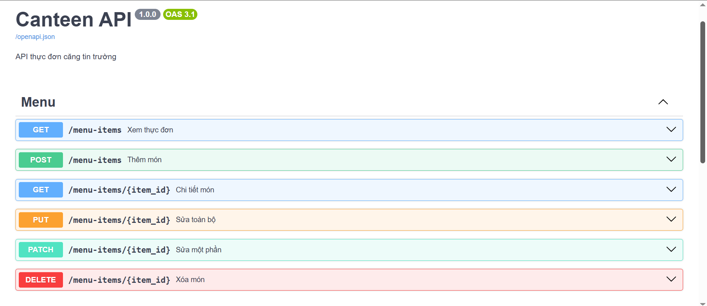
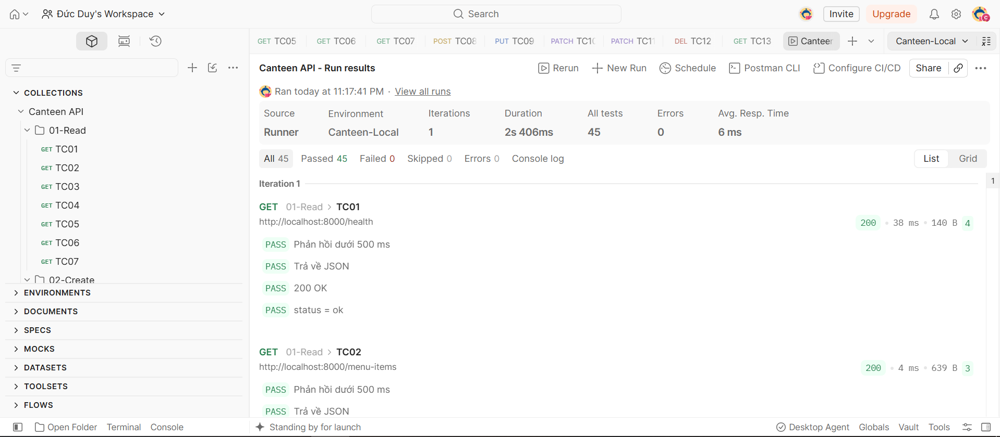
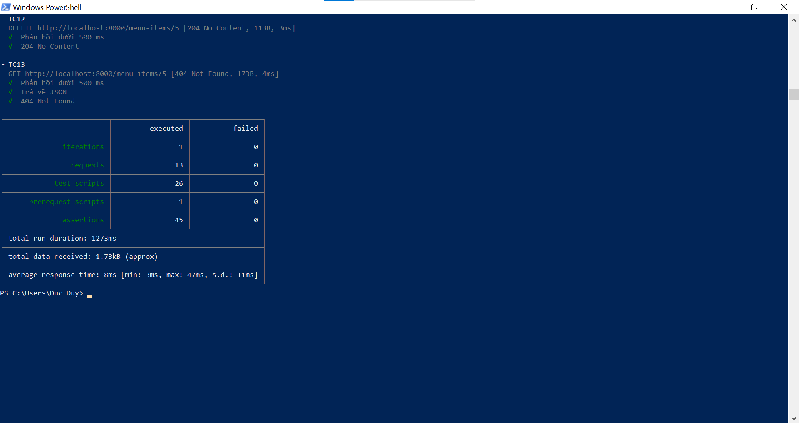
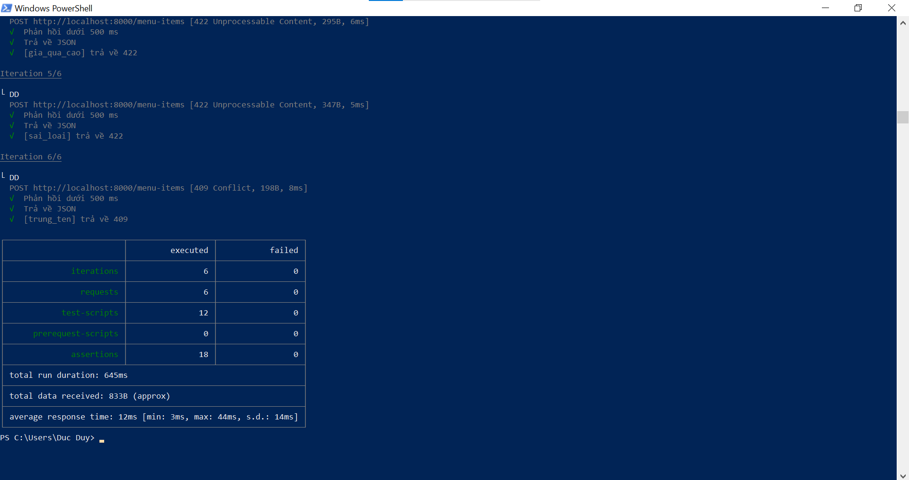

# Canteen API

API thực đơn căng tin trường, viết bằng FastAPI. Lab 5 – Lập trình mã nguồn mở.

Sinh viên: Nguyen Duc Duy – 2412111037 – CT2802

## Chạy ứng dụng

```bash
python3 -m venv .venv
source .venv/bin/activate
pip install -r requirements.txt
python -m uvicorn app.main:app --reload
```

Tài liệu API: http://127.0.0.1:8000/docs

## Cấu trúc

| Tệp | Vai trò |
|---|---|
| `app/schemas.py` | Dữ liệu vào/ra, kiểm tra BR2, BR3 |
| `app/repository.py` | Lưu trữ trong bộ nhớ, 4 món mẫu |
| `app/routers/menu.py` | 6 endpoint CRUD, kiểm tra BR1 |
| `app/main.py` | Khởi tạo ứng dụng |
| `docs/design.md` | Thiết kế tài nguyên và endpoint |
| `postman/` | Collection, environment, dữ liệu CSV |

## Kiểm thử

Khởi động lại server trước mỗi lần chạy để dữ liệu về 4 món mẫu.

```bash
npx newman run postman/Canteen-API.postman_collection.json \
  -e postman/Canteen-Local.postman_environment.json \
  --folder 01-Read --folder 02-Create --folder 03-Update --folder 04-Delete

npx newman run postman/Canteen-API.postman_collection.json \
  -e postman/Canteen-Local.postman_environment.json \
  --folder 05-Data-driven -d postman/negative.csv
```

Ghi chú: Postman bản miễn phí đã chuyển tính năng chạy Runner với tệp dữ liệu sang gói trả phí, nên phần kiểm thử hướng dữ liệu (CSV) được chạy bằng Newman.

## Minh chứng

### Swagger


### Postman Collection Runner (13 test case, 45 assertions, 0 failed)


### Newman – 13 test case


### Newman – data-driven với CSV (6 trường hợp)

